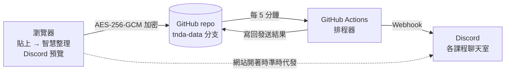

# TNDA Relay｜課務發報台

> 貼上公告，準時送到每個 Discord 頻道。

老師每天要在 Discord 的十幾個聊天室發上課提醒、作業截止、補課通知與表單。
TNDA Relay 把「整理格式、選頻道、記得準時發」這三件事自動化：

1. **貼上**：把原始文字丟進網頁，例如「下週三晚上 6:30-9:30 上課，地點 302 教室，記得帶筆電」。
2. **整理**：系統自動辨識類型、日期時間、截止日、地點、連結、攜帶物品，組成 Discord 卡片，並即時預覽學生會看到的樣子。
3. **排程**：選好頻道與時間（或一次建立「截止前 3 天／1 天／當天」的提醒鏈），存進 GitHub。
4. **發送**：GitHub Actions 每 5 分鐘檢查一次，時間到就發到 Discord，並把每個頻道的結果記錄下來。

沒有自己的伺服器、不需要付費：網站放在 **GitHub Pages**、資料放在 **GitHub repo**、排程交給 **GitHub Actions**。

- 正式網址（開啟 Pages 後）：<https://tndaixd2026-dot.github.io/TNDA/>

---

## 功能

| | |
| --- | --- |
| 智慧整理 | 辨識中文日期（明天、下週三、10/21（三）、11月5日）、時間區間（19:00-22:00、下午 1:30～4:30）、截止日（「前繳交」）、地點、連結與攜帶物品。寫錯星期會提醒；內文的「明天」「下週三」會自動改成實際日期，排程之後發送也不會錯。 |
| Discord 預覽 | 模擬 Discord 深色／淺色介面，時間戳以「發送當下」顯示（例如「3 天後」）。 |
| 多頻道 | 依你匯入的群組分組（例如大群組、各課程、業師、測試區）；從內文辨識課程名稱與類型，自動建議頻道；學員與業師頻道分開標示，混發會警告。 |
| 提醒鏈 | 一則作業自動建立多次提醒；Discord 會即時計算倒數，所以每次提醒都顯示正確的剩餘時間。 |
| 每週重複 | 固定的上課提醒設定一次，每週同一時間發送，訊息裡的時間也會跟著往後推。 |
| 發文紀錄 | 所有貼文與每個頻道的發送結果，可搜尋、依狀態／類型／群組篩選、匯出 CSV。 |
| 行事曆 | 月曆同時顯示發文、上課與截止時間；桌機上把排程拖到別天就能改期。 |
| 撤回與修改 | 發錯可以一鍵從 Discord 撤回，或直接修改已發送訊息（Discord 會顯示「已編輯」）。 |
| 準時發送 | 免費的外部定時器每 5 分鐘叫醒排程器，排程器會等到指定時間才送出；網站開著時，時間一到也會由瀏覽器直接送出。 |
| 端對端加密 | 貼文、頻道 Webhook、設定都用 AES-256-GCM 加密後才存到公開 repo。 |
| 多裝置 | 在設定頁產生「裝置連結」QR Code，手機掃描就能使用同一份資料。 |
| 不重複、不漏發 | 發送前先用 Git 的版本比對「認領」貼文，排程器與多台裝置同時運作也只會送出一次；Discord 暫時故障會自動重試，狀態不明時交給老師確認。 |

---

## 上線步驟（第一次，約 15 分鐘）

### 1. 開啟 GitHub Pages

1. 打開 repo 的 **Settings → Pages**。
2. **Build and deployment → Source** 選 **GitHub Actions**。
3. 到 **Actions** 分頁，點左側「**部署網站**」→ **Run workflow**。
4. 跑完（約 1 分鐘）後，網站就在 <https://tndaixd2026-dot.github.io/TNDA/>。

> 之後只要推送程式碼到預設分支，網站會自動重新部署。

### 2. 連接 GitHub、建立加密資料空間

打開網站 → 「**連接我的 GitHub**」，照畫面操作：

1. 點「建立 Fine-grained Token 頁面」，設定：
   - **Repository access**：Only select repositories → `tndaixd2026-dot/TNDA`
   - **Repository permissions**：
     - Contents：**Read and write**
     - Secrets：**Read and write**
     - Actions：**Read and write**
   - Expiration：建議一年
2. 把產生的 `github_pat_…` 貼回網站，按「檢查並繼續」。
3. 網站會產生一組**同步金鑰**（`TNDA-XXXX-…`）。**請務必備份**（複製到密碼管理器或下載備份檔），遺失就無法解開資料。
4. 按「建立並繼續」：網站會建立加密的 `tnda-data` 分支，並自動把同步金鑰存成 Actions Secret `TNDA_SYNC_KEY`，排程器就能開始工作。

### 3. 匯入 Discord 頻道

把整理好的 Webhook 清單**原封不動貼上**（就是下面這種格式），網站會自動建立所有群組與頻道並加密儲存。群組與頻道名稱只會出現在加密資料裡，不會寫進程式碼：

```
【A｜大群組名稱】
公告欄
https://discord.com/api/webhooks/…
交流區
https://discord.com/api/webhooks/…

【B｜三-課程名稱 課號】
課程公告
https://discord.com/api/webhooks/…
課後作業
https://discord.com/api/webhooks/…
…

【測試區】
https://discord.com/api/webhooks/…
```

接著按「送出測試訊息」到**測試區**確認連線，就完成了。

### 4. 設定準時發送（外部定時器，約 5 分鐘）

GitHub 內建的定時排程對新 repo 常常好幾個小時才跑一次（實測約每 3～5 小時），所以要用免費的 [cron-job.org](https://cron-job.org/) 每 5 分鐘叫醒排程器。網站「**設定 → 準時發送設定**」有可直接複製的內容：

1. 建立一個**只給定時器用**的 Fine-grained Token：Repository access 只選這個 repo，權限只要 **Actions：Read and write**（碰不到資料）。
2. 在 cron-job.org 建立 cronjob：
   - URL：`https://api.github.com/repos/tndaixd2026-dot/TNDA/actions/workflows/scheduler.yml/dispatches`
   - Execution schedule：Every 5 minutes
   - ADVANCED → Request method：`POST`
   - Headers：`Authorization: Bearer <定時器 Token>`、`Accept: application/vnd.github+json`
   - Request body：`{"ref":"<預設分支>","inputs":{"reason":"cron"}}`（網站上會顯示實際的分支名稱）
3. 5 分鐘後，「設定 → 準時發送設定」右上角會顯示「運作中」。

### 5. 其他裝置

在已設定的裝置打開 **設定 → 連結其他裝置**，用手機掃 QR Code；或在新裝置選「我已經在其他裝置設定過」，輸入 Token 與同步金鑰。

---

## 日常使用

1. **撰寫新貼文** → 貼上文字（或點範本）。
2. 檢查「整理結果」與右側 Discord 預覽，需要的話直接修改。
3. 選頻道與時間：「指定時間」「提醒鏈」或「立即發送」。
4. 在「發送排程」「行事曆」查看即將發送的內容；在「發文紀錄」查看每個頻道是否送達、重送失敗的頻道或撤回訊息。

快捷鍵：撰寫頁按 <kbd>Ctrl</kbd>／<kbd>⌘</kbd> + <kbd>Enter</kbd> 直接送出。所有時間都是**台北時間**，人在國外打開也一樣。

---

## 運作方式



- 每則貼文是 `tnda-data` 分支上的一個加密檔（`posts/p_xxxx.json`），檔名是隨機代號，不含內容。
- 寫入時帶上檔案的 Git sha，別人（排程器或另一台裝置）先改過就會被拒絕、重新讀取再合併，資料不會互相覆蓋。
- 發送前先把頻道標成「發送中」並寫回（認領），寫入成功的一方才發送，因此不會重複發文。
- 公開 repo 的 Actions 紀錄所有人都看得到，所以排程器只印出貼文代號與數量，不印內容。

更多技術細節見 [docs/ARCHITECTURE.md](docs/ARCHITECTURE.md)。

---

## 安全與隱私

- **Webhook 等同發文權限**：只會以加密形式存在 `tnda-data` 分支，不會出現在程式碼或 Actions 紀錄中。
- **群組與頻道名稱**：同樣只存在加密資料中，程式碼裡沒有內建任何課程或群組名稱。
- **公開 repo 看得到的**：程式碼，以及資料分支上加密檔的數量與更新時間（看不到內容）。
- **同步金鑰**：只存在你的裝置瀏覽器與 GitHub Actions Secret。
- **GitHub Token**：只存在你的裝置瀏覽器，建議只授權這一個 repo。
- 如果 Webhook 外流：到 Discord 頻道「編輯頻道 → 整合 → Webhook」刪除並重新建立，再到網站「頻道 → 批次匯入」更新。
- 中斷某台裝置：設定 → 中斷連線並清除這台裝置的資料。

---

## 常見問題

**排程時間到了，但還沒發出去？**
先確認「設定 → 準時發送設定」顯示「運作中」。沒有外部定時器時，GitHub 內建排程可能好幾個小時才跑一次。網站開著時會「準時代發」；也可以在「設定 → 排程器」按「立即執行一次」。

**Actions 頁面寫「TNDA_SYNC_KEY 與資料不符」？**
到網站「設定 → 排程器 → 重新設定排程器金鑰」。

**Token 過期了？**
重新建立一個相同權限的 Token，在網站「設定 → 中斷連線」後重新連接（輸入同一組同步金鑰即可，資料都還在）。

**60 天沒發文，排程會不會被 GitHub 停用？**
公開 repo 長時間沒有活動時，GitHub 可能停用定時排程。排程器每天會呼叫一次 GitHub API 重新啟用自己；萬一還是被停用，到 Actions 分頁的「排程發送」按 **Enable workflow** 即可。

**可以先試用嗎？**
網站首頁選「先看看 Demo」，用範例資料體驗所有功能，不會真的發到 Discord。

---

## 開發

```bash
npm install
npm run dev         # 本機開發 http://localhost:5173
npm test            # 單元測試（解析器、加密、排程器）
npm run typecheck   # 型別檢查
npm run build       # 建置正式版到 dist/
npm run build:demo  # 建置單一 HTML 的 Demo 到 dist-demo/
```

排程器可以在本機執行（需要 Node.js 22.18 以上）：

```bash
GITHUB_REPOSITORY=tndaixd2026-dot/TNDA GITHUB_TOKEN=github_pat_… TNDA_SYNC_KEY=TNDA-… npm run scheduler
```

| 目錄 | 內容 |
| --- | --- |
| `src/core/` | 瀏覽器與排程器共用：加密、GitHub API、Discord Webhook、發送引擎、頻道 |
| `src/format/` | 智慧整理（中文日期解析）、Discord 訊息組裝、Markdown 預覽 |
| `src/data/` | 網頁的狀態管理、Demo／GitHub 兩種資料後端、設定精靈 |
| `src/pages/`、`src/ui/` | 畫面 |
| `scripts/scheduler.ts` | GitHub Actions 執行的排程器 |
| `.github/workflows/` | `deploy.yml` 部署網站、`scheduler.yml` 每 5 分鐘發送 |
| `tests/` | Vitest 測試（含假的 GitHub API 與 Discord） |

技術：Preact、TypeScript、Vite、WebCrypto（AES-256-GCM／HKDF）、tweetnacl（Actions Secret 加密）。
